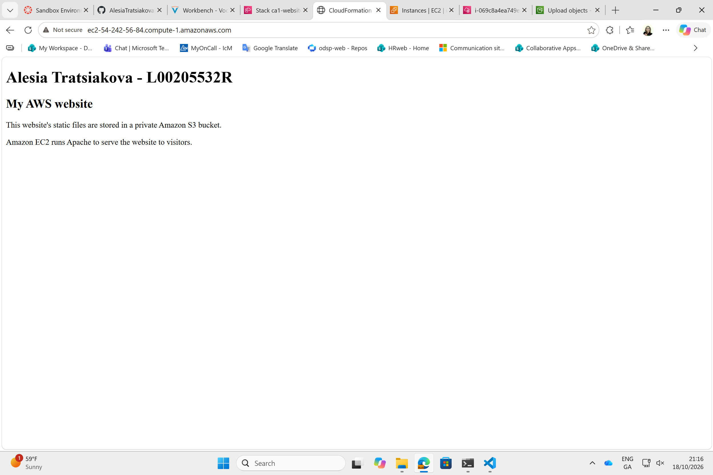
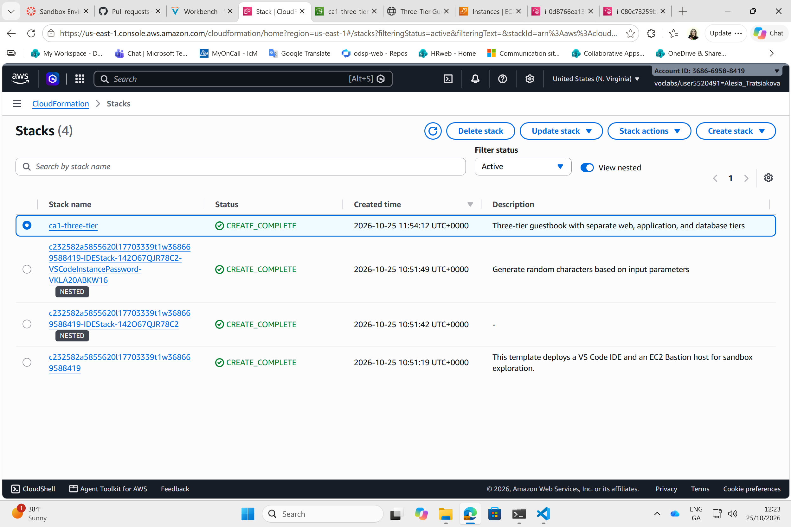
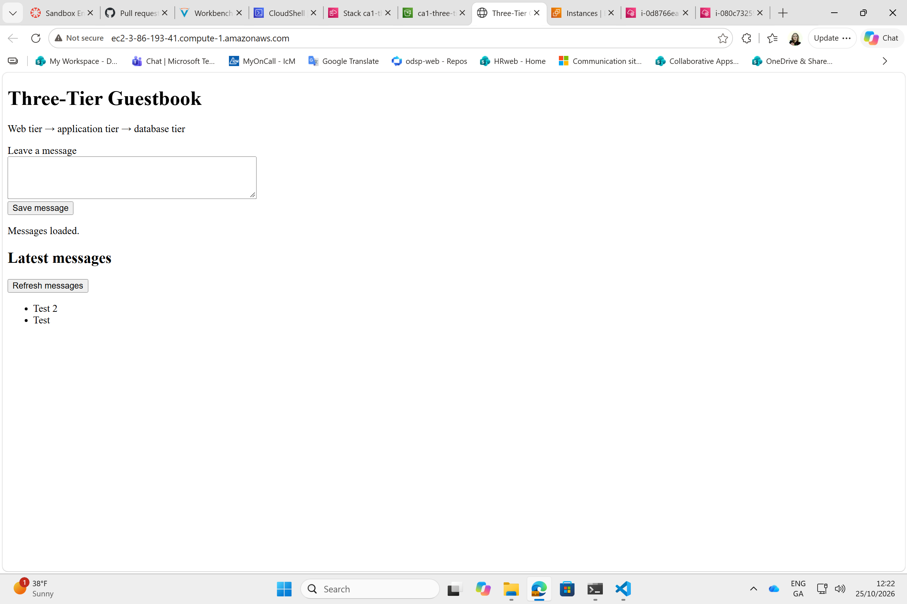
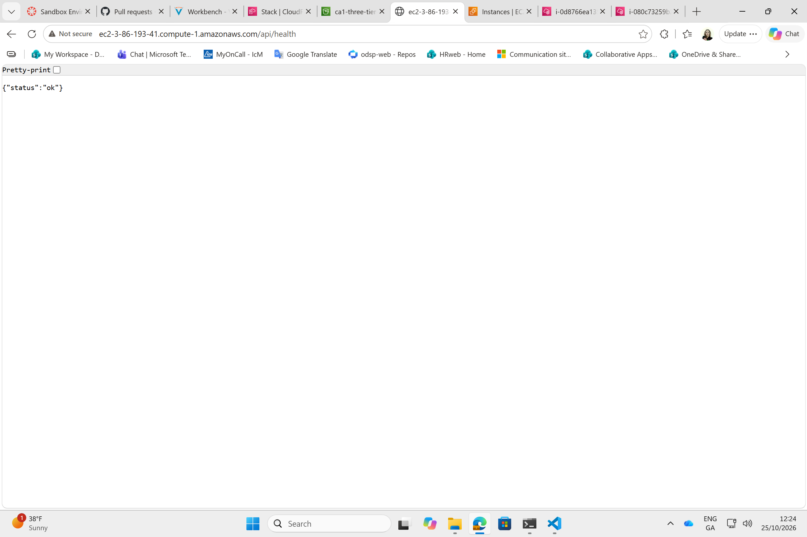

# CloudFormation Lab

## What I built

For this lab, I worked on two separate CloudFormation setups:

- A static website served by Apache on EC2, with the HTML stored in a private S3 bucket. The page shows my name and L-number.
- A three-tier guestbook where visitors can save messages and view previous entries.

The main files are [Template.yaml](Template.yaml) for the first setup and [ThreeTier.yaml](ThreeTier.yaml) for the second. Website content is in [website](website), and the guestbook code, dependencies, schema, and installation script are in [guestbook](guestbook).

## Architecture

### Static website

```text
Browser -- HTTP:80 --> EC2 / Apache
                            ^
                            | downloads index.html over HTTPS
                       Private S3 bucket
```

I used the default VPC for this setup. S3 stores the source page, while Apache serves a local copy. A systemd timer checks S3 approximately every minute and replaces the page only after a successful download. The `MyIP` parameter controls HTTP access; its default allows public access.

### Three-tier guestbook

```text
Browser
   | HTTP:80
Nginx web server          Public subnet
   | HTTP:8000
Flask / Gunicorn server   Private application subnet
   | MySQL:3306 with verified TLS
RDS MySQL                Private database subnets
```

This setup has its own VPC. Security groups allow application requests only from the web tier, and database connections only from the application tier. The application uses a NAT gateway for outbound downloads and AWS API calls. The database subnets have no internet default route.

RDS needs subnets in two Availability Zones, but my database is Single-AZ. The second subnet does not provide a standby database.

Both EC2 servers download files from a private code bucket. Application provisioning retries until the files are available and the database health check succeeds. The administrator password is retrieved from SSM Parameter Store. Bootstrap creates a separate SQL user with only `SELECT` and `INSERT` permissions on the messages table. Gunicorn then runs as an unprivileged Linux user.

## How I extended the examples

I started with AWS's [first-stack tutorial](https://docs.aws.amazon.com/AWSCloudFormation/latest/UserGuide/gettingstarted.walkthrough.html) and [S3 snippets](https://docs.aws.amazon.com/AWSCloudFormation/latest/UserGuide/quickref-s3.html).

The main changes were:

- Replacing inline Hello World HTML with separate files stored in S3.
- Using Amazon Linux 2023, encrypted disks, IMDSv2, and a configurable instance profile.
- Keeping S3 private and adding an HTTPS-only policy to the first website's bucket.
- Adding separate web, application, and database tiers.
- Adding input validation, parameterized SQL, and verified database TLS.
- Using systemd for installation retries, service restarts, and health checks.

The sandbox blocked IAM role creation, so I used `LabInstanceProfile`. It also blocked Secrets Manager creation, but allowed encrypted SSM parameters. The lab required `gp2` storage and did not support RDS Multi-AZ or enhanced monitoring. These restrictions influenced the final design.

## Deployment

Both setups need an active lab account and an existing instance profile with the required permissions. The first also needs a default VPC; the second needs two usable Availability Zones.

### Static website

1. Create `ca1-website` in CloudFormation using `Template.yaml`, `LabInstanceProfile`, and an allowed instance type such as `t3.micro`.
2. After stack creation, find `WebsiteBucketName` in Outputs.
3. Upload `website\index.html` directly into that bucket, keeping it private.
4. Wait for the download timer, then open `WebsiteURL`.

### Guestbook

1. Create `/ca1/guestbook/database-password` in Parameter Store as a Standard `SecureString`, using the default SSM key and a unique generated password. Keep it in the deployment region.
2. Create `ca1-three-tier` using `ThreeTier.yaml`, `LabInstanceProfile`, and `t3.micro`.
3. After creation, find `ApplicationCodeBucketName` in Outputs.
4. Upload `app.py`, `bootstrap.py`, `schema.sql`, `requirements.txt`, `setup.sh`, and `index.html` from `guestbook` directly into the bucket. Save `setup.sh` with LF line endings.
5. Allow provisioning to finish, open `GuestbookURL`, save a message, and refresh.
6. Open the same URL followed by `/api/health`. The expected response is `{"status":"ok"}`.

Passwords are not stored in the repository. The generated application credentials are kept in a root-readable environment file. CloudFormation's `CREATE_COMPLETE` status does not mean the application has finished starting.

## Testing and problems I fixed

During development, I used `cfn-lint`, AWS `validate-template`, and Python compilation checks. These passed for the versions checked, but they did not catch runtime problems.

| Problem | Fix |
|---|---|
| IAM role creation caused rollback | Used the existing lab instance profile |
| EC2 startup failed to install `awscli2` | Corrected the package name to `awscli-2` |
| API returned HTTP 500 when reading the RDS certificate | Changed `/etc/guestbook` to mode `755`, while keeping the credentials file at `600` |

I inspected cloud-init and systemd logs through Session Manager to diagnose the startup failures. The fixes were also saved in the repository.

The initial static website worked after a manual S3 download. The guestbook successfully saved and retrieved messages after the repairs, and its health endpoint returned `{"status":"ok"}`.

### Screenshots

**Static website:** the required header, from the initial deployment.



**Three-tier stack:** infrastructure creation completed.



**Guestbook:** saved messages displayed after the startup fixes.



**Health check:** the public endpoint reached the application and database.



These screenshots do not demonstrate a clean deployment of the final corrected version.

## Best practices and limitations

I kept the application and database private, encrypted storage, and avoided hard-coded passwords. The API validates messages up to 500 characters, uses SQL parameters, and renders visitor messages as text rather than HTML.

There are still important limitations:

- Public and web-to-application traffic use HTTP. HTTPS would be needed beyond this demonstration.
- The shared lab role is broad, rather than a custom least-privilege role.
- One server per tier, one NAT gateway, and Single-AZ RDS leave single points of failure.
- There is no load balancer, Auto Scaling, authentication, or rate limiting.
- Small instances and a 50-message result limit suit the lab, but connection pooling and load testing would be needed for higher traffic.
- Direct Python dependencies are pinned, but AMIs and other dependencies are not fully fixed.

Separating the tiers makes their responsibilities clearer and allows independent sizing. It also adds cost and complexity compared with the first website. The NAT gateway and RDS can incur charges even when EC2 is stopped.

## Git workflow and AI assistance

I initially committed directly to `main`, then moved to feature branches and PRs for the template improvements and guestbook. Validation was manual; a future CI workflow could run checks before merging and automate artifact uploads. A complete CI/CD pipeline is not implemented.

GitHub Copilot CLI helped with explanations, code suggestions, troubleshooting, and this README. Its assistance included the application and deployment scripts, not just the basic AWS template.

These are **summaries of the prompt directions**, not exact quotations:

- Explain the requirements and assess official AWS templates as starting points.
- Guide incremental changes for private S3 content, encryption, and reusable parameters.
- Design a small three-tier guestbook within AWS Academy restrictions.
- Add database initialization, validated API requests, and automatic service startup.
- Diagnose deployment failures from logs and suggest checks.
- Draft a concise report with references and deployment evidence.

## References

Alongside the two starting tutorials linked above, the following documentation supports the configuration:

- AWS CloudFormation: [instance profiles](https://docs.aws.amazon.com/AWSCloudFormation/latest/TemplateReference/aws-resource-iam-instanceprofile.html), [IMDSv2 settings](https://docs.aws.amazon.com/AWSCloudFormation/latest/TemplateReference/aws-properties-ec2-instance-metadataoptions.html), and [EBS settings](https://docs.aws.amazon.com/AWSCloudFormation/latest/TemplateReference/aws-properties-ec2-instance-ebs.html).
- AWS networking: [VPC](https://docs.aws.amazon.com/AWSCloudFormation/latest/TemplateReference/aws-resource-ec2-vpc.html), [subnets](https://docs.aws.amazon.com/AWSCloudFormation/latest/TemplateReference/aws-resource-ec2-subnet.html), [NAT gateway](https://docs.aws.amazon.com/AWSCloudFormation/latest/TemplateReference/aws-resource-ec2-natgateway.html), and [security groups](https://docs.aws.amazon.com/AWSCloudFormation/latest/TemplateReference/aws-resource-ec2-securitygroup.html).
- AWS: [S3 HTTPS policy](https://docs.aws.amazon.com/AmazonS3/latest/userguide/example-bucket-policies.html#example-bucket-policies-use-case-ssl-requests-only), [RDS resource](https://docs.aws.amazon.com/AWSCloudFormation/latest/TemplateReference/aws-resource-rds-dbinstance.html), [SSM secure references](https://docs.aws.amazon.com/AWSCloudFormation/latest/UserGuide/dynamic-references-ssm-secure-strings.html), and [RDS TLS certificates](https://docs.aws.amazon.com/AmazonRDS/latest/UserGuide/UsingWithRDS.SSL.html).
- AWS: [AL2023 package comparison](https://docs.aws.amazon.com/linux/al2023/ug/amzn2-al2023-ami.html), used to check `awscli-2`.
- [cfn-lint](https://github.com/aws-cloudformation/cfn-lint), [Flask](https://flask.palletsprojects.com/), [Gunicorn](https://docs.gunicorn.org/), and [PyMySQL](https://pymysql.readthedocs.io/en/latest/modules/connections.html).
- [systemd services](https://www.freedesktop.org/software/systemd/man/latest/systemd.service.html), [timers](https://www.freedesktop.org/software/systemd/man/latest/systemd.timer.html), and [Nginx proxy configuration](https://nginx.org/en/docs/http/ngx_http_proxy_module.html).
- AWS Academy service restrictions supplied with the course sandbox.
